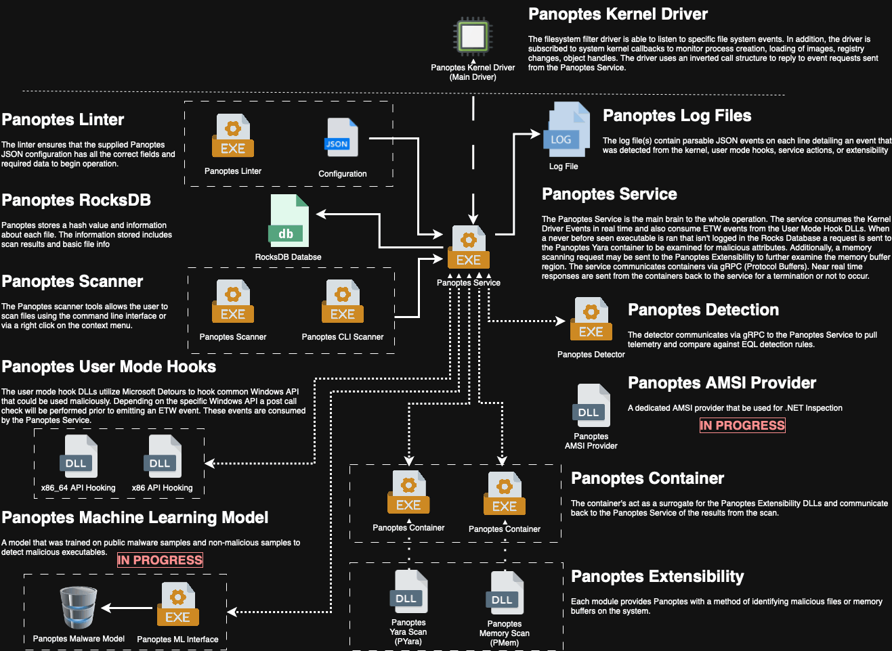
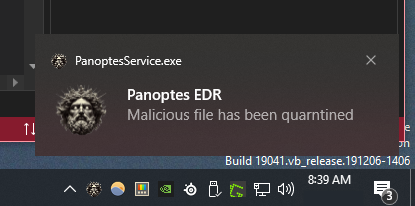
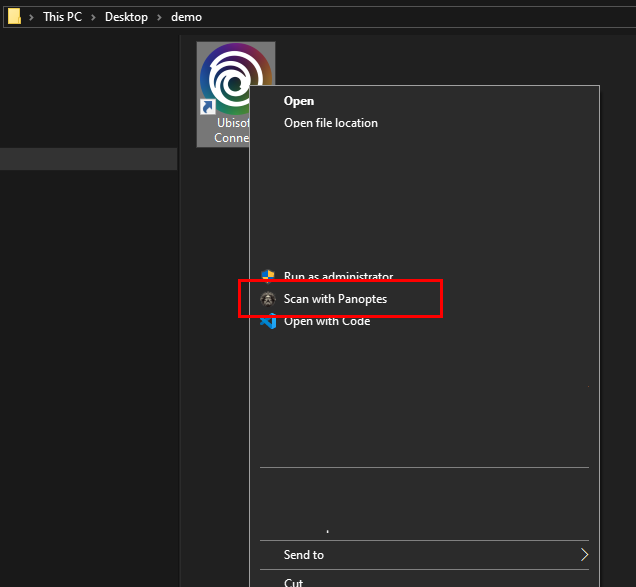
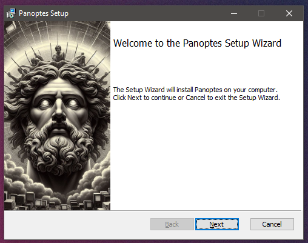
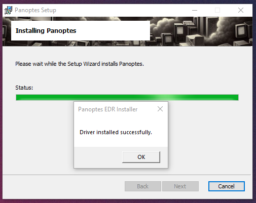
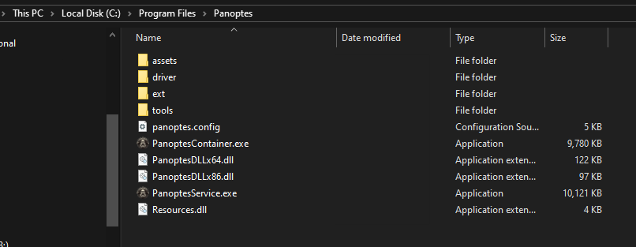
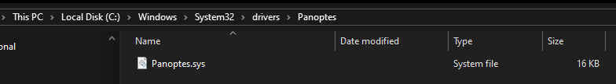
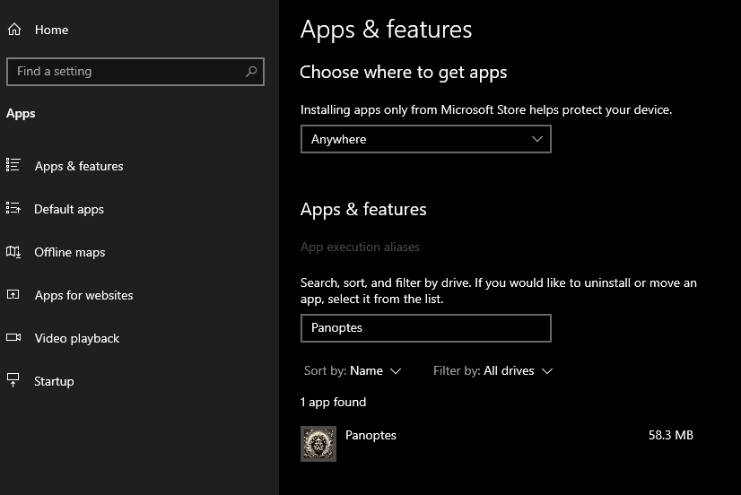

# Panoptes Endpoint Detection and Response

<p align="center">
<br />
</p>

## Overview

Panoptes is an Endpoint Detection and Response (EDR) system designed for educational purposes to understand Windows Kernel Drivers, ETW, and Windows system interactions. **This is not intended for production use.**

## Demo

[Link to video](https://youtu.be/U_L-zY7IxYM)

## Features

- Kernel driver with process, image load and file system minifilter callbacks ([details](src/driver/README.md))
- Kernel-level DLL injection using a kernel Asynchronous Procedure Call (kAPC)
- Userland ntdll hooks for code injection and process tampering techniques ([details](src/hook/README.md))
- Static analysis using Yara-X with custom rules, and Authenticode signature verification using WinVerifyTrust ([details](src/extensibility/README.md))
- Fault-isolated scanning: each scanning module runs in its own container process
- Persistent storage using RocksDB, so files already scanned are not scanned again
- JSON (NDJSON) logs compatible with ELK, [HELK](https://github.com/Cyb3rWard0g/HELK), and other SIEM solutions, and a [terminal log viewer](tools/README.md)
- JSON configuration file with a built-in linter
- Right-click context menu integration and a command-line interface for scanning
- MSI installer for easy installation and removal
- Unit tests for the Yara module, the linter and every hooked API

## About the Name

Panoptes, meaning "all-seeing," comes from Greek mythology. Argus Panoptes was a giant with a hundred eyes who served as a guardian to the Greek Gods. [Learn more about Argus Panoptes](https://en.wikipedia.org/wiki/Argus_Panoptes)

## Architecture

Panoptes is designed with flexibility in mind, allowing users to customize deployment through a JSON configuration file. Panoptes is also packaged using [Wix Toolset](https://www.firegiant.com/wixtoolset/) MSI file for easy installation and uninstallation.

<p align="center">
<br />
</p>

Panoptes has four parts. The driver and the hook DLL only produce events; `PanoptesService` does all of the logging and decides what to scan. Each component's folder has a README with the details.

| Component | Role |
|-----------|------|
| [Kernel driver](src/driver/README.md) (`Panoptes.sys`) | Process, image load and file system minifilter callbacks. Injects the hook DLL into new processes. |
| [Hook DLL](src/hook/README.md) (`PanoptesDLLx64.dll`, `PanoptesDLLx86.dll`) | Hooks ntdll inside each injected process to catch code injection and process tampering. |
| [`PanoptesService`](src/service/README.md) | Collects the driver's and the hooks' events, writes the log, queues scans, quarantines detections and shows tray notifications. Reads the [configuration](src/service/README.md#configuration). |
| [Containers](src/container/README.md) and [extensibility modules](src/extensibility/README.md) | Scan files for the service, each module in its own process. `PanoptesYara` is the core module. |
| [Scanners](src/scanner/README.md) | `PanoptesScan` (right-click menu) and `PanoptesScanCLI` ask the service to scan a file. |
| [Linter](src/linter/README.md) | Checks a configuration file. |
| [Tools](tools/README.md) | A terminal UI for browsing logs by process. |

How the components talk:
- **Driver to service:** the driver's device object, `\\.\Panoptes`. The service keeps `IOCTL_PANOPTES_GET_EVENT` requests pending and the driver completes them with events (inverted call). The service configures the driver through IOCTLs on the same device.
- **Hook DLL to service:** ETW. Each injected process writes to the `Panoptes.Hook` TraceLogging provider, which the service consumes through a real-time session.
- **Service, containers and scanners:** gRPC (`proto/src/panoptes.proto`), on a port the service publishes in the registry.

Every event ends up in one log, `C:\ProgramData\Panoptes\Logs\pano.log`, one JSON object per line. Created and modified PE files are scanned once their writes settle.

## Installation

1. Download the MSI installer from the Releases page
2. To use the Panoptes Kernel Driver ensure that testsigning is enabled using the following command:
   ```powershell
   bcdedit /set TESTSIGNING ON
   ```
   Then restart your system
3. Run the MSI installer
4. Place compiled Yara-X rules (`rules.pkg`) in `C:\Program Files\Panoptes\` (see [compiling custom rules](src/extensibility/README.md#panoptesyara))
5. Start `PanoptesService.exe` as Administrator

## Usage

- Right-click files and choose **Scan with Panoptes**, or use `PanoptesScanCLI.exe -file <file>` ([scanners](src/scanner/README.md))
- Monitor tray notifications for detections
- Check quarantine folder: `C:\ProgramData\Panoptes\Quarantine`
- View logs in `C:\ProgramData\Panoptes\Logs`, or browse them by process with the [log viewer TUI](tools/README.md):
  ```powershell
  pip install textual
  python tools/pano_tui.py C:\ProgramData\Panoptes\Logs\pano.log
  ```

## Development Setup

### Prerequisites

- [Visual Studio 2026](https://visualstudio.microsoft.com/) with C++ desktop development workload
- [vcpkg](https://vcpkg.io/en/) (included with Visual Studio or standalone)
- [Windows Driver Kit (WDK)](https://learn.microsoft.com/en-us/windows-hardware/drivers/download-the-wdk) (for kernel driver builds)
- Test signing enabled (for driver development)
- Virtual Machine configured for Windows Kernel Debugging using WinDbg

Set the `VCPKG_ROOT` environment variable to your vcpkg installation:
```powershell
# If installed with Visual Studio
$env:VCPKG_ROOT = "C:\Program Files\Microsoft Visual Studio\2022\Professional\VC\vcpkg"

# Or set it permanently
[System.Environment]::SetEnvironmentVariable("VCPKG_ROOT", "C:\Program Files\Microsoft Visual Studio\2022\Professional\VC\vcpkg", "User")
```

For kernel development environment setup, see:
- [Ap3x/Windows-Kernel-Development-Infrastructure](https://github.com/Ap3x/Windows-Kernel-Development-Infrastructure)
- [Microsoft WDK Installation Guide](https://learn.microsoft.com/en-us/windows-hardware/drivers/download-the-wdk)

### Building with CMake

The project uses a single CMake preset with the Visual Studio multi-config generator. You configure once and choose Debug/Release at build time.

#### Configure
```powershell
cmake --preset default
```

#### Build
```powershell
# Debug build (with debug symbols for your code)
cmake --build build/default --config Debug

# Release build (optimized)
cmake --build build/default --config Release
```

#### Build the Kernel Driver
```powershell
cmake --preset default -DBUILD_DRIVER=ON
cmake --build build/default --config Debug --target PanoptesDriver
```

#### Build and Run Tests
```powershell
cmake --preset tests
cmake --build --preset tests --config Debug
```

```powershell
cd bin/Debug/tests
./Test_PanoptesYara.exe
./Test_Linter.exe
```

Each hooked API also has a test for both architectures, e.g. `Test_NtWriteVirtualMemoryx64.exe` and `Test_NtWriteVirtualMemoryx86.exe`. They only test anything in Debug builds; see the [hook README](src/hook/README.md#tests) for how they work, how to debug them, and how to run them on a KDNET target.

### CMake Build Options

The following options can be passed during configuration with `-D`:

| Option | Default | Description |
|--------|---------|-------------|
| `BUILD_DRIVER` | OFF | Build the kernel driver package (requires WDK) |
| `BUILD_GRPC` | ON | Generate gRPC code from protobuf definitions |
| `BUILD_TESTS` | OFF | Build the unit tests into `bin/<config>/tests` (enabled by the `tests` preset) |
| `BUILD_DOC` | OFF | Build Doxygen documentation |
| `BUILD_WIX_INSTALLER` | OFF | Build the Wix MSI installer package |

Example with multiple options:
```powershell
cmake --preset default -DBUILD_DRIVER=ON -DBUILD_DOC=ON
cmake --build build/default --config Release
```

#### Building the MSI Installer

The MSI installer requires the WDK (for the driver) and the [WiX Toolset v5](https://wixtoolset.org/) CLI:

```powershell
dotnet tool install --global wix --version 5.0.2
```

The required WiX extensions (`WixToolset.UI.wixext`, `WixToolset.Util.wixext`) are installed automatically during CMake configuration. Then configure and build with the `installer` preset, which enables `BUILD_DRIVER` and `BUILD_WIX_INSTALLER` and builds every packaged binary in Release:

```powershell
cmake --preset installer
cmake --build --preset installer
```

In VS Code, select the **MSI Installer** configure preset and the **MSI Installer (Release)** build preset in the CMake Tools status bar, then run **CMake: Build**.

The MSI will be output to `bin/Release/installer/PanoptesInstaller.msi`.

## Screenshots of Panoptes Features
### Scanning and Detecting Malicious Activity Notification

<p align="center" >
<br />
</p>

<p align="center" >
<br />
</p>

### MSI Installer 

<p align="center" >
<br />
</p>


<p align="center" >
<br />
</p>

<p align="center" >
<br />
</p>

### Installed Locations

<p align="center" >
<br />
</p>


<p align="center" >
<br />
</p>

### Easily Uninstall in App and Programs Menu in Settings

<p align="center" >
<br />
</p>

## Roadmap

- [ ] Component-specific documentation
- [ ] Add more NTDLL hooks for monitoring

## Future Plans

### PanoptesLite

A lighter, driver-less edition of Panoptes. Instead of the kernel driver, PanoptesLite would collect its telemetry only from ETW providers (for example `Microsoft-Windows-Kernel-Process` and `Microsoft-Windows-Kernel-File`), while still using the same extensibility (Yara) containers for scanning. This makes it installable where loading a kernel driver isn't possible or wanted, at the cost of the visibility and enforcement the driver provides.

## References

- [Kernel Callback Functions](https://codemachine.com/articles/kernel_callback_functions.html)
- [EDR Kernel Callbacks](https://pre.empt.blog/2023/maelstrom-5-edr-kernel-callbacks-hooks-and-call-stacks)
- [Windows EDR Telemetry](https://www.edr-telemetry.com/windows)
- [ETW Events Overview](https://artefacts.help/windows_etw_overview.html)
- [Windows Security Event IDs](https://www.ultimatewindowssecurity.com/securitylog/encyclopedia/default.aspx)
- [LOL Drivers Yara Rules](https://github.com/magicsword-io/LOLDrivers/tree/main/detections/yara)
- [Installing Test Certifications](https://learn.microsoft.com/en-us/windows-hardware/drivers/install/installing-test-certificates)


